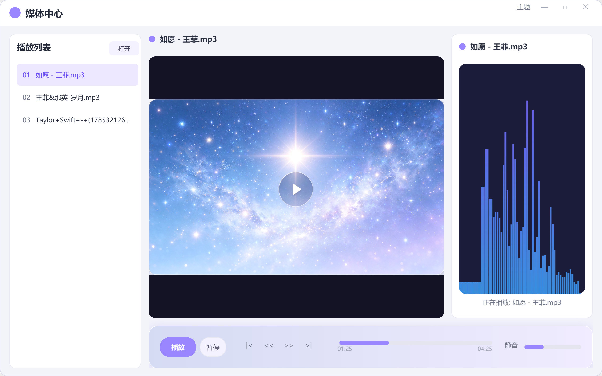
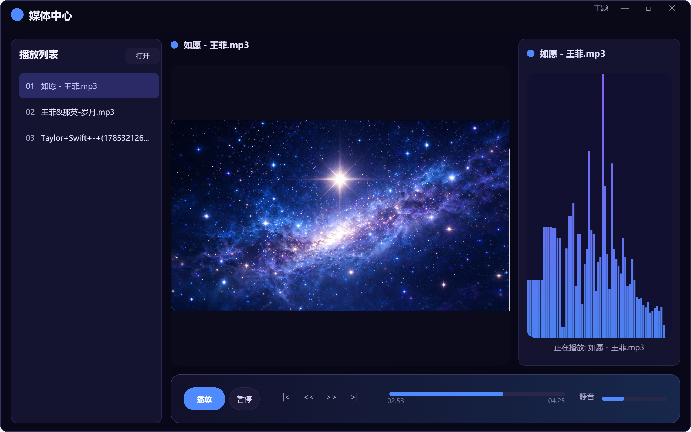
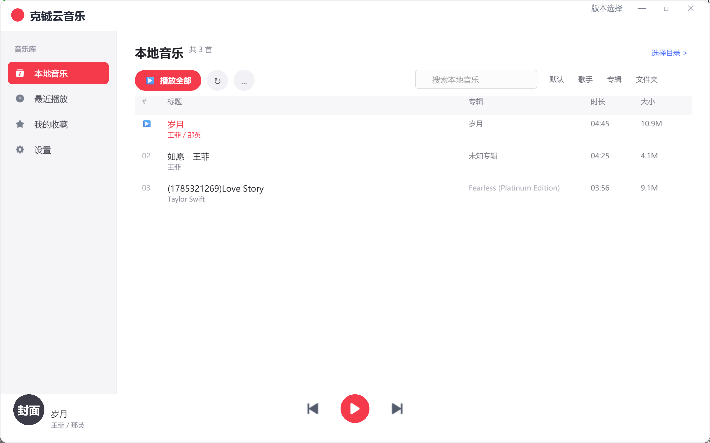
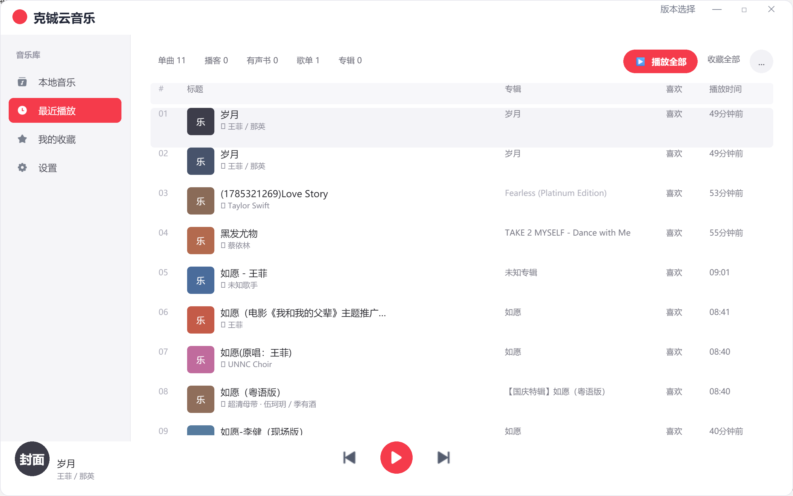

# KC-EchoPlayer 克铖音视频播放器

本项目包含两个可切换的版本，用户可通过右上角“版本选择”进行切换。纯粹播放器版本基于Duilib与BASS开发，是一款Windows音乐播放器，支持多格式音频播放与实时频谱可视化，通过BASS获取FFT数据，并利用GDI+动态绘制频谱图。克铖云音乐版本参考网易云音乐设计，采用全新界面风格，同样基于Duilib技术栈实现。两个版本在保留核心播放能力的基础上，分别面向纯粹播放体验与云音乐界面体验，满足不同使用场景需求。

### 运行效果截图

